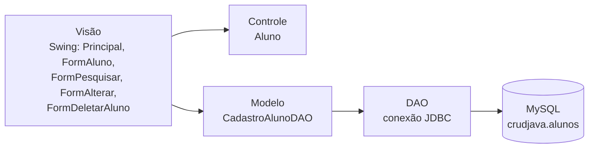

<h1 align="center">Sistema de Cadastro de Alunos 🎓</h1>

<p align="center">
  <b>Aplicação desktop em Java (Swing) com CRUD de alunos em MySQL, organizada em MVC e com padrão DAO.</b>
</p>

<p align="center">
  
  
  
  
</p>

<p align="center">
  <a href="#-como-rodar-localmente">Rodar localmente</a> ·
  <a href="#-arquitetura">Arquitetura</a> ·
  <a href="#-decisões-técnicas">Decisões técnicas</a>
</p>

---

## 🎯 O problema

Um cadastro escolar simples precisa incluir, buscar, alterar e excluir alunos sem perder dados. O objetivo do projeto foi resolver isso **separando bem as responsabilidades**: tela, regras e acesso ao banco, em vez de misturar SQL dentro dos formulários.

> Projeto de estudo para praticar **POO, MVC e o padrão DAO** em Java.

## ✅ A solução

Uma aplicação desktop com telas Swing para cada operação, que conversa com o MySQL somente através de uma classe DAO.

**Funcionalidades**

- Cadastrar aluno (nome, idade e e-mail; a matrícula é gerada pelo banco).
- Pesquisar aluno por matrícula e listar todos.
- Alterar os dados de um aluno.
- Excluir aluno pela matrícula.

## 📸 Demonstração

<!-- Adicione prints das telas em docs/img/ e descomente:
| Tela principal | Cadastro | Pesquisa |
|---|---|---|
|  |  |  |
-->
🎬 *Prints das telas em breve.*

## 🛠️ Tecnologias

| Camada | Tecnologia | Por que escolhi |
|---|---|---|
| Linguagem | Java | Praticar POO com tipagem forte (encapsulamento, classes de entidade). |
| Interface | Java Swing (NetBeans GUI Builder) | Telas desktop montadas visualmente, deixando o foco na arquitetura. |
| Banco de dados | MySQL | Persistência relacional da tabela `alunos`. |
| Acesso a dados | JDBC + `PreparedStatement` | Consultas parametrizadas, sem concatenar valores no SQL. |
| Build | Ant (projeto NetBeans) | Padrão do NetBeans para projetos Java desktop. |

## 🧱 Arquitetura



**Estrutura**

```
src/br/com/
├── visao/     # telas Swing (cadastro, pesquisa, alteração, exclusão)
├── controle/  # Aluno: matrícula, nome, idade, e-mail
└── model/     # DAO (conexão) e CadastroAlunoDAO (inserir, pesquisar, editar, deletar)
```

## 💡 Decisões técnicas

- **Padrão DAO**: todo SQL fica em `CadastroAlunoDAO`; as telas não conhecem o banco. Trocar o MySQL por outro banco afetaria só essa camada.
- **`PreparedStatement` em todas as consultas**: os valores entram como parâmetros, o que evita SQL injection e erros de aspas.
- **Matrícula gerada pelo banco** (auto incremento): o sistema não precisa controlar a sequência e não há risco de matrícula duplicada.
- **Uma tela por operação**: cada formulário tem uma responsabilidade, deixando o fluxo simples para o usuário. *Trade-off:* mais classes de interface.

## 🚀 Como rodar localmente

**Pré-requisitos:** JDK 8+, MySQL e NetBeans (ou outra IDE com suporte a Ant).

1. Crie o banco e a tabela (script compatível com as consultas do DAO):

   ```sql
   CREATE DATABASE crudjava;
   USE crudjava;
   CREATE TABLE alunos (
     mat   INT AUTO_INCREMENT PRIMARY KEY,
     nome  VARCHAR(100) NOT NULL,
     idade INT,
     email VARCHAR(100)
   );
   ```

2. Ajuste usuário e senha do MySQL em `src/br/com/model/DAO.java`.
3. Abra o projeto no NetBeans. O driver `mysql-connector-j-8.0.33.jar` já está na raiz do repositório; adicione-o às bibliotecas se a IDE não reconhecer.
4. Execute a classe `br.com.visao.Principal`.

## 🗺️ Próximos passos

- [ ] Ler credenciais do banco de um arquivo de configuração em vez do código.
- [ ] Remover a pasta `build/` e o pacote duplicado `entidade/` do repositório.
- [ ] Migrar para Maven e adicionar testes do DAO com JUnit.

## 👤 Autor

**Diego Marcelo**, Desenvolvimento de Software e Dados
[LinkedIn](https://linkedin.com/in/diegomarcelo) · [GitHub](https://github.com/diegoomarcelo) · diegoomarcelo@gmail.com
